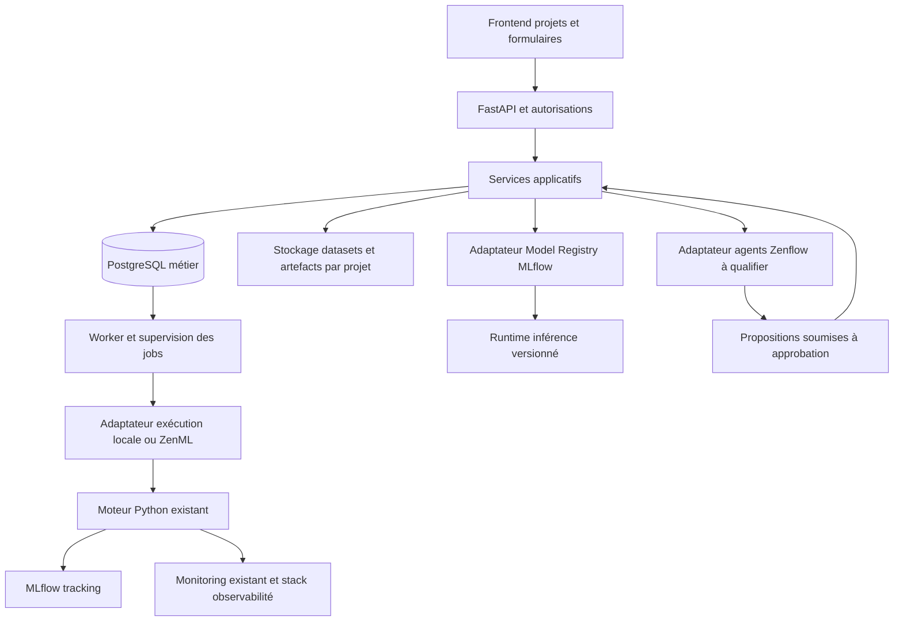

# SignalFlow — audit et feuille de route de finalisation

Audit initial : 16 novembre 2026, limité à la phase 1. Les sections d’audit ci-dessous
conservent cet état historique et ses résultats.

**Mise à jour après autorisation « continue » : phase 2 livrée et validée.**
L’API Python sans YAML, les contrats et les schémas embarqués sont disponibles ;
280 tests passent et la wheel a été vérifiée hors dépôt. Voir le
[compte rendu de phase 2](phase2_python_api.md). Les phases 3–12 restent à réaliser.

## 1. Conclusion de l’audit

SignalFlow est actuellement un moteur local de classification supervisée, piloté
par YAML/CLI, avec traçabilité MLflow, mesures psutil, benchmarks et observabilité
Docker opérationnelle dans l’environnement examiné. Ce n’est pas encore une
application MLOps multi-utilisateur. Le socle de calcul doit être réutilisé ; les
principaux travaux concernent le contrôle applicatif, la persistance métier, la
sécurité entre projets et le cycle de vie des jobs/modèles.

### Preuves revérifiées pendant cette session

| Contrôle | Résultat actuel | Portée et réserves |
| --- | --- | --- |
| `.venv/bin/python -m pytest -q` | **252 réussis, aucun ignoré, 148,05 s** | Suite existante, comprenant des entraînements réels ; Docker exclu par défaut |
| `.venv/bin/python -m pytest --compose tests/compose/test_stack.py -q` | **6 réussis, 1 échec, 11,08 s** | Contrôles en lecture seule ; échec de la fenêtre temporelle Loki détaillé ci-dessous |
| `docker compose config --quiet` | Succès | Configuration valide, pas une preuve suffisante à elle seule |
| `docker compose ps` | Sept services actifs ; cinq avec healthcheck sain | Loki et Alloy n’ont pas de healthcheck Docker ; leurs endpoints sont vérifiés par le test dédié, réussi |
| API `/api/v1/targets` Prometheus | Six targets `up` : alloy, cadvisor, loki, node, prometheus, signalflow | Constat à l’instant du contrôle |
| Requêtes des trois dashboards et datasources | Test réussi | Vérification API, pas de nouvelle vérification visuelle navigateur pendant cet audit |
| MLflow et métriques d’un run terminé | Test réussi | Lecture des résultats conservés ; tests locaux exécutent aussi de nouveaux runs temporaires |
| Format OpenMetrics et séries hôte/conteneurs | Tests réussis | Exposition HTTP et présence de vraies séries |
| `.venv/bin/python -m pip check` | Aucune dépendance cassée signalée | Ne constitue ni audit CVE ni preuve de compatibilité avec ZenML |
| `git diff --check` | Succès | Changements préexistants conservés |
| Packaging, installation isolée, reprise après panne | Preuves historiques du 15 novembre consultées | Pas de reconstruction/installation ni de test d’arrêt de stack cette session |

Le bilan historique « 8 tests Docker réussis » n’est **pas** réannoncé comme un
résultat actuel. Les sept tests de `test_stack.py` ont été rejoués. Le huitième,
`test_recovery.py`, arrête Loki puis toute la stack, lance des entraînements et
réécrit une preuve locale : il n’a pas été exécuté dans cet audit non perturbateur.

**Échec reproduit :** `test_loki_has_events_for_real_run` dépend de
`outputs/observability-validation/demo-report.json` et cherche son run dans les
24 dernières heures. Le run `0345a30dbfda4c3b94fb5c96bafb9850` a environ 25,94 h.
Une interrogation en lecture seule sur six jours retrouve 32 événements, dont deux
occurrences de `train_succeeded` : les doublons sont compatibles avec la livraison
au moins une fois documentée. Les données sont présentes ; le test n’est pas
reproductible indépendamment de l’âge de sa fixture. Ne pas élargir simplement la
fenêtre indéfiniment : une future fixture doit produire son propre run dans un
espace de validation dédié, ou interroger les dates du run avec une rétention connue.

### Git et données préexistantes

HEAD observé : `26bd91a feat(observability): integrate Prometheus Grafana Loki and Alloy`.
À l’entrée : vingt fichiers suivis modifiés et sept fichiers non suivis. Les
modifications concernent README, Compose, documentation, exemples, Alloy,
dashboards, scripts, modules d’observabilité et tests de télémétrie.
Les fichiers non suivis préexistants sont :

- `.env.example`
- `docs/observability_stack.md`
- `docs/observability_validation.md`
- `scripts/measure_observability_overhead.py`
- `tests/compose/test_recovery.py`
- `tests/compose/test_stack.py`
- `tests/conftest.py`

Ils sont nécessaires à la livraison existante mais ne seraient pas tous présents
dans un clone de HEAD. Le seul fichier de source/documentation ajouté par cette
phase est **ce document**. Aucun staging, commit, publication, changement de
configuration de service, arrêt, suppression de volume ou migration MLflow.
Les tests ordinaires produisent leurs fichiers temporaires de validation.

`.gitignore` exclut secrets, `.env`, bases SQLite, modèles, wheels, caches et outputs.
La recherche des chemins suivis correspondant à ces principaux artefacts n’en a
pas trouvé. Ce contrôle de noms n’est pas un scan exhaustif de secrets ni d’historique.

## 2. Carte des fonctionnalités et ordre de développement

« Opérationnel » signifie implémentation et preuves disponibles dans le périmètre
local décrit ; « partiel » ne signifie pas que la cible web est livrée.

| Fonctionnalité | État réel / preuve | Dépendances pour la cible | Critère de validation cible | Phase |
| --- | --- | --- | --- | --- |
| YAML, JSON Schema, chemins confinés | Opérationnel, `config/loader`, tests | Contrats métier en mémoire | Parité YAML/objets, mêmes refus de données invalides | 2 |
| API Python d’entraînement | Partielle : callable synchronique dépendant d’un dossier YAML | Contrats d’exécution typés, injection des chemins/adaptateurs | Entraîner sans aucun fichier YAML, garder la CLI | 2 |
| Projets et utilisateurs | Absents ; `project.yaml` n’est pas un CRUD | API, identité, PostgreSQL | Deux projets et deux utilisateurs isolés | 3–4 |
| API FastAPI/OpenAPI | Absente du code applicatif | Extra explicite, schémas et services | API contractuelle testée, sans entraînement dans une requête | 3 |
| Authentification/RBAC | Absents | Vérification d’identité, memberships persistants | 401/403 et refus d’accès croisé sur chaque ressource | 3–4, renforcé 12 |
| Configurations graphiques et historique | Absent ; snapshots JSON par run seulement | Versions PostgreSQL, schémas canoniques | Historique append-only, snapshot indépendant des éditions ultérieures | 4, 9 |
| Lecture de datasets | Opérationnelle : builtins, CSV numérique ≤32 Mio, synthétique | Réemploi du validateur | Mêmes règles de données et partitions | Préserver |
| Upload/versionnement de datasets | Absent ; hash actuel sans archivage des données | Stockage de fichiers + métadonnées + RBAC | Upload borné, contenu validé, référence immuable, aucune traversée | 5 |
| Régression logistique et évaluation | Opérationnelles, huit scores validation/test | Moteur existant | Pas de fuite de prétraitement, résultats équivalents | Préserver 2–7 |
| Jobs asynchrones et annulation | Absents ; subprocess du benchmark ne constitue pas une file durable | Transactions PostgreSQL, worker isolé | Reprise après crash, annulation observable, transitions atomiques | 6 |
| Pipeline graphique / ZenML | Absent ; étapes fixes, pas de DAG utilisateur | Fonctions d’étapes, runtime ZenML compatible | Plusieurs étapes réelles, reprise contrôlée, pas de double tracking | 7, 9 |
| Suivi MLflow | Opérationnel, SQLite et artefacts locaux | Résolution du tracking par projet/run | Runs historiques conservés, liaison app/ZenML/MLflow explicite | Préserver 4–8 |
| Comparaison d’expériences | Partielle : benchmarks et client MLflow, pas de service/UI | Requêtes autorisées, protocole comparable | Signalement de conditions incompatibles, scores et dispersion visibles | 8–9 |
| Model Registry | Absent ; joblib sauvegardé ≠ modèle enregistré | Promotion d’artefact de confiance, registre MLflow | Version immuable, provenance, droits et alias contrôlés | 8 |
| Inférence, déploiement, rollback | Absents | Registry, signature d’entrée, runtime séparé | Publication saine, rollback vérifié, données invalides rejetées | 10 |
| Monitoring, Prometheus/OpenMetrics | Opérationnels localement | Adaptation future à plusieurs workers | Pas de double sonde ; agrégation sans pertes/conflits ni labels run | 6, 12 |
| Grafana, Loki, Alloy | Opérationnels avec limites locales documentées | Politique d’accès et logs projet pour cible partagée | Aucune fuite interprojet via dashboards/logs | 12, conception dès 3 |
| Agents IA / Zenflow | Absents ; produit à identifier explicitement | Adaptateur isolé, accès filtrés, budget et approbations | Proposition explicable ; aucune action sensible sans accord serveur | 11 |
| Interface web métier | Absente ; Grafana n’est pas cette interface | API stabilisée et sécurité | Parcours complet sans édition manuelle de YAML | 9–10 |
| Livraison reproductible/CI | Tests et packaging présents ; pas de `.github/` observé | Environnements verrouillés et tests autonomes | Installation propre, wheel, migrations et E2E reproductibles | Chaque phase, clôture 12 |

## 3. Architecture existante et qualité des API

- `cli.py` : deux commandes, `train` et `benchmark`, JSON stdout et erreurs typées
  stderr. `--help` ne nécessite pas les SDK ML.
- `config/loader/` : lectures bornées, YAML strict, refus des doublons et références
  de schémas externes, résolution confinée ; composants à conserver.
- `tools/registry.py` : factories Python explicites et imports différés ; un nom connu
  ne signifie pas intégration opérationnelle. Aucun rollback général des factories.
- `ml/config.py` : validation métier puis `RunConfiguration` ; la liste des étapes
  et les outils autorisés sont fixes. Les schémas sont lus depuis le dossier utilisateur.
- `ml/runner.py` : configuration, orchestration, fichiers, suivi et instrumentation.
  L’entrée `run_training(config_dir, *, output_dir, training_override)` retourne un
  `dict[str, Any]`. Bonne façade CLI, mais pas encore contrat applicatif indépendant.
- `ml/adapters/sklearn.py` : `TrainingResult`, apprentissage et évaluation sans MLflow ;
  reçoit déjà des dictionnaires et une instrumentation injectée. Réemploi prioritaire.
- `ml/adapters/data.py` : chargement, empreinte et indices séparés. Les appels directs
  supposent les déclarations et chemins prévalidés ; ne pas les exposer tels quels au web.
- `ml/adapters/mlflow.py` : client par instance, URI SQLite locale construite côté serveur,
  exceptions neutralisées. `start()` est requis avant log/finish. Création concurrente
  de l’expérience non arbitrée ; pas de registre/promotion ni injection de backend distant.
- `monitoring/` : protocole `Instrumentation.stage`, implémentation nulle, sonde psutil
  et fermeture du thread. La future architecture doit réutiliser ce point d’extension.
- `observability/` : snapshots atomiques verrouillés, métriques bornées et logs JSON ;
  exporteur permanent et Alloy évitent les requêtes réseau dans le calcul ML.
- `benchmarking/` : processus neufs séquentiels, conditions/empreintes comparées,
  statistiques. Pas de stockage durable de file de jobs ni de reprise applicative.

Points de qualité constatés : annotations et docstrings utiles, erreurs métier,
responsabilités d’adaptateurs séparées, tests de fuite/reproductibilité, suivi des
échecs et imports optionnels. Points à améliorer à l’occasion du besoin réel :

1. `RunConfiguration`/`LoadedConfiguration` sont `frozen`, mais leurs dictionnaires
   restent mutables. `snapshot()` partage ces objets. Ce n’est pas une immutabilité
   profonde ni une protection contre les mises à jour concurrentes.
2. Beaucoup de `dict[str, Any]` et des `cast` entre orchestrateur et factories :
   formaliser les contrats aux frontières, sans transformer tout le registre générique.
3. Configuration, schémas et chemins sont contrôlés par un opérateur local de confiance.
   Un client HTTP ne doit choisir ni son schéma de validation, ni `output_dir`, ni un
   chemin de dataset, ni une variable d’environnement ou une factory.
4. `SklearnTrainer.train` regroupe plusieurs étapes : extraire des fonctions réutilisables
   uniquement quand l’adaptateur ZenML doit les orchestrer séparément (phase 7).
5. Une interruption locale est traitée comme FAILED ; aucun état CANCELLED, bail de
   worker ou mécanisme durable de réconciliation n’existe.
6. Les diagnostics de publication finale sont ajoutés au résultat CLI après écriture
   du rapport local : définir en phase 6 une source de vérité persistante des diagnostics.
7. `config/project.yaml` contient des déclarations aspirantes (agents, registre,
   déploiement, security_scan) et des références sans implémentation associée. Le
   chargeur générique ne matérialise pas tout le pipeline. Les exemples de classification
   sont la référence exécutable ; les noms de phases du fichier racine ne sont pas des preuves.

## 4. Dépendances, sécurité et risques de régression

Environnement constaté : SQLAlchemy **2.0.57**, FastAPI **0.162.7**, Pydantic
**2.14.3**, MLflow skinny **3.18.0**, pytest **9.2.0**. ZenML, Zenflow et psycopg
ne sont pas installés. FastAPI/Pydantic sont présents dans l’environnement mais
pas déclarés comme dépendances applicatives directes de SignalFlow : leur présence
ne prouve pas l’existence d’une API. L’écart SQLAlchemy 2.1.8 décrit dans le rapport
historique n’est plus celui observé aujourd’hui.

Conserver les extras indépendants : moteur, `ml`, `monitoring`, `observability` ;
ajouter ultérieurement `api`, `postgres`, et un environnement d’exécution ZenML
isolé si les contraintes divergent. Ne pas installer ZenML dans `.venv` pendant cet
audit. Les plages de pyproject ne constituent pas un verrou reproductible ; maintenir
ensuite des contraintes testées par environnement, sans ajouter un gestionnaire
ou un broker tant qu’il n’est pas justifié.

| Risque | Constat / impact | Mesure prévue et phase |
| --- | --- | --- |
| Changement de comportement YAML | CLI et benchmark dépendent des contrats actuels | Façade compatible, tests de parité et erreurs, phase 2 |
| Divergence JSON Schema/Pydantic/UI | Schémas copiés entre config et exemples | Source canonique versionnée, tests d’équivalence ; schémas historiques conservés, 2–4 |
| Mutabilité des snapshots | Dictionnaires partagés | Copie défensive et stockage append-only avec digest canonique, 2–4 |
| Multi-utilisateur | Aucune identité/ACL, chemins locaux et Grafana Viewer anonyme | RBAC dès API, stockage par projet ; ne pas exposer la stack actuelle à des tenants, 3–5/12 |
| Artefact joblib malveillant | Désérialisation Python de confiance nécessaire | Aucune importation de pickle/joblib utilisateur ; provenance/hash et runtime isolé, 8–10 |
| Fichiers et consommation mémoire | Limite CSV ne borne pas seule les allocations du parseur/fit | Streaming upload, quotas lignes/colonnes/taille, CPU/RAM/temps worker, 5–6 |
| Courses de chemins | Vérifier puis ouvrir n’isole pas un écrivain hostile concurrent | Dossiers non modifiables par les clients, clés opaques, ouvertures sûres, 5 |
| SQLite MLflow et concurrence | Suivi local, création d’expériences non synchronisée | Worker initial limité, allocation du suivi par projet, migration explicite ultérieure si nécessaire, 6–8 |
| Perte de job ou double effet | Aucun état transactionnel intersystème | Idempotence, baux, outbox et réconciliation ; aucune promesse exactly-once, 6–7 |
| Métriques multi-hôtes | Verrou de fichier local, pas de mécanisme distribué | Limiter d’abord à un hôte ; backend de publication explicite avant distribution, 6/12 |
| Observabilité expose les projets | Logs et modèles locaux sans contrôle applicatif | Proxy/accès autorisés, redaction, pas de run_id en labels Prometheus, 3/12 |
| Sockets moteur Docker | cAdvisor monte Docker/containerd ; `:ro` ne borne pas leur API | Isoler du backend et documenter la confiance ; worker sans socket, 6/12 |
| Reprise Alloy | Composants public preview, capacité et rétention finies | Versions figées et tests d’arrêt/reprise sur stack dédiée, 12 |
| Agents / prompt injection | Futurs résultats et logs sont des entrées non fiables | Outils en liste fermée, aucune commande libre, approbation liée à une action exacte, 11 |

Aucun scan CVE, pentest, audit exhaustif de secrets, mesure de charge multi-utilisateur
ou validation d’une matrice Python complète n’a été exécuté dans cette phase.

## 5. Architecture cible proposée — non implémentée

### Propriété des données et responsabilités

- **PostgreSQL métier** : projets, identités externes, memberships/rôles, versions de
  configurations, métadonnées de datasets, jobs/événements, déploiements et approbations.
  Un schéma Alembic propre à SignalFlow ; ne jamais migrer les tables internes MLflow.
- **Fichiers** : stockage local géré pour le premier produit, hors webroot et hors Git,
  séparé des métadonnées. Clés opaques attribuées côté serveur ; référence de version
  immuable plutôt qu’un chemin fourni par le client. Adaptateur objet distant seulement
  si un déploiement le requiert.
- **MLflow** : source des paramètres, scores et artefacts ML ; Model Registry utilisé
  par un adaptateur de promotion. PostgreSQL conserve des références/permissions,
  pas un deuxième registre concurrent. Préserver les SQLite historiques sans migration
  implicite ; tout changement de backend exige sauvegarde et validation séparées.
- **ZenML** : orchestration des étapes déterministes et références de provenance.
  L’application possède l’état du job utilisateur ; elle conserve les identifiants
  d’exécution ZenML et MLflow et réconcilie leurs statuts, sans deux gestionnaires de retry
  indépendants sur la même opération.
- **Worker** : exécution hors processus web, quota et arrêt contrôlés. Une file PostgreSQL
  suffit initialement ; Redis/Celery/Kubernetes ne sont pas présupposés nécessaires.
- **Agents** : analyse de résumés autorisés, propositions et preuves. Aucun privilège
  de modification de projet, d’entraînement ou de déploiement par défaut.

### Contrats à figer avant implémentation

- `TrainingSpec` : version de schéma, modèle/hyperparamètres, seed, partition,
  référence de dataset et options métier autorisées. Paramètres d’infrastructure,
  secrets et chemins réservés au `ExecutionContext` serveur.
- `TrainingReport` : identifiants, statut, métriques, références d’artefacts, diagnostic
  typé et référence de provenance. DTO HTTP sans chemins absolus ni traces sensibles.
- `ConfigurationVersion` : id, projet, numéro/version, schéma, contenu JSON canonique,
  digest, auteur, date et parent éventuel. Modification = nouvelle version ; contrôle
  optimiste via version attendue/ETag. Snapshot du job figé à son acceptation.
- `DatasetVersion` : projet, id/version, hash des octets, format, taille et schéma de
  colonnes ; distinguer hash du fichier et empreinte sémantique calculée par le moteur.
- `Job` : `QUEUED → RUNNING → SUCCEEDED | FAILED`; annulation `QUEUED → CANCELLED`
  ou `RUNNING → CANCELLING → CANCELLED`. Course fin/annulation arbitrée par mise à jour
  conditionnelle ; ne pas déclarer CANCELLED avant arrêt confirmé. Retry = tentative
  tracée, avec bornes, idempotence et traitement explicite des effets déjà publiés.
- API : `/api/v1`, erreurs `{code, message, details_sanitized, request_id}` ; 401/403,
  404 sans fuite interprojet, 409 pour conflits, 413 pour taille, 422 pour validation.
  `POST .../runs` renvoie 202 après persistance durable, jamais après simple lancement
  d’un thread en mémoire. Clé d’idempotence liée au projet et au contenu de requête.
- Événements : SSE avec autorisation, identifiant monotone et reprise Last-Event-ID ;
  progression par phase, pas de faux pourcentage sklearn. Polling possible au départ.
- Sécurité : identité OIDC proposée avec vérification signature/issuer/audience/expiration ;
  rôles projet viewer, editor, operator, owner. Aucun bypass de test dans la configuration
  de production. Choix du fournisseur d’identité avant exposition du backend.

## 6. Étude ZenML et clarification Zenflow

### ZenML

La documentation officielle décrit les orchestrateurs comme des composants de
stack et avertit des contraintes de dépendances des intégrations. Le choix initial
proposé est l’orchestrateur local, avec un vrai découpage en étapes ; aucun besoin
Kubernetes pour valider ce contrat. [Orchestrateurs](https://docs.zenml.io/stacks/stack-components/orchestrators),
[environnements Python](https://docs.zenml.io/user-guides/best-practices/configure-python-environments).

La branche officielle `main` consultée annonce ZenML 0.98.1, Python >=3.10,<3.15
et Pydantic <=2.12.5. Le Pydantic 2.14.3 installé dépasse cette borne : **incompatibilité
statique avec cette définition**, pas résultat d’un essai d’installation. Cette
branche mobile n’est pas une release sélectionnée. Choisir une release/tag immuable,
résoudre et tester ses dépendances en environnement séparé avant engagement.
[Définition officielle consultée](https://github.com/zenml-io/zenml/blob/main/pyproject.toml).

L’intégration MLflow officielle consultée déclare `mlflow>=2.1.1,<4` et d’autres
exigences, dont python-rapidjson et des intégrations numpy/pandas. Cela ne démontre
pas une compatibilité complète avec Python 3.13 et le seul `mlflow-skinny` présent.
Éviter un deuxième run automatique MLflow par étape ; définir un propriétaire unique
du cycle de tracking. [Code de l’intégration](https://github.com/zenml-io/zenml/blob/main/src/zenml/integrations/mlflow/__init__.py).

### Zenflow : identité du produit non décidée

Deux produits distincts ont été identifiés ; aucun paquet n’est installé ni exécuté :

- **Zenflow Code de Zencoder** : application de bureau orchestrant des agents de
  développement, tâches et worktrees. Ces capacités ne prouvent pas l’existence
  d’un SDK Python embarquable ou d’une API serveur de diagnostics ML. Une intégration
  MCP ne signifie pas automatiquement une API permettant à SignalFlow de lancer
  ses workflows. [Documentation produit](https://docs.zencoder.ai/zenflow/overview).
- **zenflow.sh** : autre projet, avec CLI, workflows et API Go. Un adaptateur de
  processus/service pourrait être étudié ; licence, maintenance, authentification,
  annulation, approbations et garanties de coûts restent à qualifier.
  [Guide officiel](https://zenflow.sh/getting-started/quick-start).

La question du produit cible a été soumise à l’utilisateur. Sans choix explicite,
la phase 11 reste conditionnelle ; cela ne bloque pas les phases 2–10. Aucun endpoint,
SDK ou mécanisme de contrôle humain n’est inventé. La preuve de faisabilité doit
montrer un appel réel documenté, son retour structuré et ses erreurs, sans autoriser
le fournisseur à appliquer directement une proposition sensible.

## 7. Plan détaillé par phase

Tous les chemins ci-dessous, sauf les fichiers existants explicitement nommés,
sont **des créations proposées**. Les noms peuvent être ajustés à la revue de phase ;
les contrats et critères d’acceptation ne peuvent pas être remplacés par des mocks seuls.
Chaque compte rendu futur doit distinguer fichiers modifiés, commandes exécutées,
résultats réels, limitations et étape suivante autorisée.

### Phase 1 — Audit et architecture cible

- **Fichier** : création de `docs/roadmap_finalisation.md` uniquement.
- **Entrées/sorties** : dépôt et preuves historiques → état réel, écarts et plan.
- **Tests** : suite locale, sept contrôles Docker sans interruption, requête Loki élargie.
- **Risques** : écraser des travaux locaux ou confondre état historique et état courant.
- **Acceptation** : preuves datées, test en échec expliqué, dépendances/absences explicites.
- **Compte rendu** : livré dans les sections 1–6 ; 252 tests locaux réussis, Docker 6/7
  sur les contrôles rejoués ; un test de reprise volontairement non rejoué.

### Phase 2 — Découpler objets Python et fichiers YAML

- **Fichiers** : modifier `ml/config.py`, `ml/runner.py` et au besoin `cli.py` ; créer
  `ml/contracts.py`, `ml/validation.py`, `config/schemas/` sous `src/signalflow/` pour
  les contrats embarqués ; adapter `pyproject.toml` pour les données de package ;
  `tests/ml/test_object_api.py`, `tests/ml/test_contract_parity.py`, `docs/pipeline.md`.
- **Entrées/sorties** : `validate_training_spec(mapping) → TrainingSpec` puis
  `run_training_spec(spec, context) → TrainingReport`. API proposée ; la façade
  `run_training(config_dir, ...)` garde sa signature et son dictionnaire de résultat.
- **Tests** : mêmes inputs en YAML/objets, invalides/NaN, indépendance des snapshots,
  mutation après validation, absence de YAML, roue hors dépôt, CLI inchangée.
- **Risques** : modification des defaults, chemins CSV, erreurs, durées instrumentées,
  imports lourds ou divergence des copies de schémas.
- **Acceptation** : entraînement réel via objet sans écrire un YAML temporaire ; mêmes
  scores/partitions/artefacts hors identifiants et temps ; 252 tests conservés.
- **Compte rendu** : livrée après autorisation ; 280 tests réussis, parité sur trois
  sources de données, wheel hors dépôt sans YAML et CLI compatibles. Les fichiers
  réellement modifiés et les limites sont détaillés dans [phase2_python_api.md](phase2_python_api.md).

### Phase 3 — API FastAPI, contrats et sécurité initiale

- **Fichiers** : `api/app.py`, `api/settings.py`, `api/errors.py`, `api/dependencies.py`,
  `api/routes/{health,schemas,configurations}.py`, `auth/{identity,policy}.py`,
  `application/configurations.py`, `tests/api/`, extra `api` dans pyproject,
  `docs/api.md`. Tous sous `src/signalflow/` sauf tests/docs/pyproject.
- **Entrées/sorties** : JSON Pydantic → contrat métier de phase 2 ; GET schémas,
  POST validation et import/export YAML sous contrôle serveur ; OpenAPI versionné.
  Routes de projet testées via un dépôt mémoire uniquement tant que phase 4 absente.
- **Tests** : TestClient, OpenAPI, payloads invalides, autorisations, erreurs expurgées,
  limites requêtes, CORS fermé ; faux fournisseur d’identité réservé aux tests.
- **Risques** : entraînement bloquant dans le web, schéma client arbitraire,
  dépendance FastAPI transitive accidentelle, introduction d’un mode auth ouvert.
- **Acceptation** : aucun fit dans une requête, contrats HTTP documentés, identité
  obligatoire pour ressources métier. Persistance/CRUD durable explicitement indisponibles.
- **Compte rendu** : non commencée ; fournisseur d’identité et mode navigateur à fixer.

### Phase 4 — PostgreSQL, projets et versions de configuration

- **Fichiers** : `persistence/{models,repositories,session}.py`, `migrations/`,
  `alembic.ini`, `application/{projects,configurations}.py`, `api/routes/projects.py`,
  compléments auth/routes, `compose.app.yaml` séparé, extra `postgres`,
  `tests/persistence/`, `tests/api/test_project_isolation.py`, `docs/database.md`.
- **Entrées/sorties** : identité + projet + document validé → version append-only ;
  GET historique/version, comparaison et export YAML. Membership et rôle persistants.
- **Tests** : vrai PostgreSQL dédié, migrations sur base vide et mise à niveau,
  rollback transactionnel, conflit de version, isolation entre utilisateurs/projets.
- **Risques** : confusion avec bases MLflow, suppression d’historique, injection SQL,
  mise à jour non atomique, fuite via listes/recherches.
- **Acceptation** : redémarrer l’API conserve projets et historique ; deux éditions
  concurrentes sont arbitrées ; copies/snapshots indépendants ; aucun volume existant touché.
- **Compte rendu** : implémentation et tests SQLite/API disponibles ; corrections de traçabilité de l’auteur, dépendances API et expiration des jetons réalisées dans un correctif de revue (commit `9d411f1`). **Validation réelle PostgreSQL effectuée le 18/11/2026** sur base jetable : migrations `0002`, `alembic check` sans écart, 2 tests `--postgres` réussis dont la concurrence, lecture après redémarrage de l’API et permissions vérifiées (403/404). Suite complète : 378 réussis, 0 avertissement. Documentation : `docs/database.md` et `docs/phase4_review.md` (logs de preuve). Aucune migration implicite de SQLite MLflow. Avant déploiement applicatif : construire les wheels et sauvegarder la base applicative.

### Phase 5 — Upload et versions de datasets

- **Fichiers** : `datasets/{service,storage,validation}.py`, `api/routes/datasets.py`,
  modèles/migration dataset_version, `tests/datasets/`, `docs/datasets.md` ; réemploi
  de `ml/adapters/data.py`, changements limités si extraction de validation nécessaire.
- **Entrées/sorties** : multipart CSV borné + nom logique/colonne cible → DatasetVersion
  validée ; téléchargement autorisé et aperçu borné, pas de chemin système exposé.
- **Tests** : dépassement taille en streaming, MIME trompeur, CSV malformé, UTF-8,
  colonnes/valeurs invalides, traversée/symlink, échec disque et nettoyage, cross-project.
- **Risques** : mémoire, archives/pièges de décompression, écriture partielle,
  incohérence commit fichier/DB, exposition de données dans logs.
- **Acceptation** : CSV uniquement au départ, aucun pickle/zip/exécutable accepté ;
  transaction de publication et collecte des temporaires orphelins définies ; version
  utilisée par un run jamais remplacée silencieusement.
- **Compte rendu** : implémentation phase 5 disponible : upload multipart borné, validation CSV en flux, versions immuables et migration `0003`, téléchargement/aperçu autorisés, collecte hors ligne des orphelins. Limite fichier 32 Mio et plafond de 1 000 000 cellules. Voir `docs/datasets.md`. Validation PostgreSQL complétée pendant la phase 6 : migrations sans écart ORM et deux publications CSV concurrentes réussies sur base jetable. Aucun déploiement applicatif.

### Phase 6 — Jobs durables, supervision et annulation

- **Fichiers** : `jobs/{service,states,worker,executor,events}.py`, `api/routes/runs.py`,
  tables jobs/attempts/events/outbox et migrations, `tests/jobs/`,
  `tests/integration/test_worker_recovery.py`, `docs/jobs.md`, compose applicatif.
- **Entrées/sorties** : versions de config/dataset + clé d’idempotence → 202 job durable ;
  statut, événements et annulation autorisés. Sous-processus appelle la phase 2.
- **Tests** : double soumission, deux prises de job concurrentes, crash avant/après
  publication MLflow, expiration bail, annulation avant/pendant fit, limites CPU/RAM/temps,
  nettoyage processus, erreurs de télémétrie, SSE reconnecté et accès refusé.
- **Risques** : double exécution, PID réutilisé, orphelins, rapports contradictoires,
  secrets hérités de l’environnement, concurrence SQLite ; pas de shell utilisateur.
- **Acceptation** : API reste réactive, reprise démontrée et transitions atomiques ;
  premier worker à concurrence limitée, état métier/MLflow réconcilié, ressources arrêtées.
- **Compte rendu** : implémentée : file PostgreSQL, soumissions idempotentes, snapshots config/dataset, worker Linux séparé, baux et clôture protégée, annulation, limites CPU/RAM/temps, événements SSE durables et outbox MLflow. Reprise conservatrice sans double entraînement. **407 tests réussis**, plus le parcours CSV réel ajouté séparément ; 5 cas PostgreSQL validés. Entraînement/récupération, SIGKILL et limites noyau vérifiés ; détails et périmètre mono-hôte dans `docs/jobs.md`. Migration `0004_jobs` validée sur base jetable, aucun déploiement applicatif.

### Phase 7 — Orchestration ZenML

- **Fichiers** : `orchestration/{contracts,local,zenml_adapter}.py`, `orchestration/steps.py`,
  extraction ciblée des étapes de `ml/adapters/sklearn.py`, contraintes runtime ZenML,
  `tests/orchestration/`, `docs/zenml.md` et complément de compose applicatif si justifié.
- **Entrées/sorties** : snapshot et références immuables → execution_id ZenML, étapes
  load/split/preprocess/fit/evaluate/save et un résultat compatible avec le moteur local.
- **Tests** : installation de la release choisie dans un environnement neuf, pipeline réel,
  cache/désactivation, échec d’étape, retry, propagation annulation et parité numérique.
- **Risques** : conflits Pydantic/MLflow, prétraitement refitté sur holdout, gros datasets
  copiés entre étapes, provenance/cache faux, doublons de runs ou compteurs.
- **Acceptation** : pas un simple wrapper autour de tout `run_training` ; plusieurs
  étapes réelles observables, un cycle de tracking défini, données/test jamais utilisées au fit.
- **Compte rendu** : implémentée avec ZenML 0.98.0 dans un runtime Python 3.14 isolé (Pydantic 2.12.5 incompatible avec le >=2.14 de l’API). Six étapes réelles, calculs partagés avec le moteur local, cache désactivé, retry de lecture borné et unique cycle MLflow. Parité, absence de fuite train/test, échec de fit, retry et worker/annulation réels validés (4 tests runtime + 1 intégration). **Correctif d’annulation livré le 19/11/2026** : ZenML 0.98.0 recalcule le statut des pipelines statiques depuis les étapes et ignore un `CANCELLED` demandé, laissant le run à `running` ; la réconciliation demande désormais `STOPPING`, clôt les étapes non terminales, puis relit le run et exige `STOPPED` avant d’acquitter l’outbox. Seul le run référencé par `output/orchestration/*/execution.json` de la tentative est touché ; un état terminal est préservé et l’absence de référence est un no-op. Dix tests de non-régression avec faux store 0.98.0 couvrent annulation active, step réessayable, idempotence, panne transitoire, annulation avant création, autres pipelines et outbox. Non-régression Python : **419 réussis, 1 ignoré** en 324,03 s ; ciblés **10 réussis, 1 ignoré** en 7,95 s. Validation Docker sur projet/volumes isolés : build `signalflow-zenml-fix:local` réussi, `ZENML_TERMINAL_STATUS_OK stopped`, `MLFLOW_TERMINAL_STATUS_OK KILLED`, `ACTIVE_PIPELINE_CANCELLATION_AND_RECONCILIATION_OK`, `API_WORKER_RESTART_PERSISTENCE_OK`. Contraintes, instructions et preuves : `docs/zenml.md` et `docs/zenml_docker_validation.md`. Aucun déploiement ni stack distante ; aucune donnée existante supprimée.

### Phase 8 — Comparaison et registre de modèles

- **Fichiers** : `experiments/{service,comparison}.py`, `models/{service,registry}.py`,
  adaptateur `models/mlflow_registry.py`, routes experiments/models, migrations de
  références métier, `tests/models/`, `docs/models.md`.
- **Entrées/sorties** : runs autorisés → tableau de comparaison et avertissements ;
  promotion explicite d’un run réussi → nom/version MLflow avec signature/provenance.
- **Tests** : conditions/datasets/splits incompatibles, métrique absente, accès interprojet,
  modèle non fiable, enregistrement idempotent, alias concurrent, tracking historique lisible.
- **Risques** : sélectionner sur le test plutôt que validation, transformer un joblib
  arbitraire en code exécutable, confondre fichier artefact et modèle MLflow enregistré.
- **Acceptation** : sélection humaine tracée, version résoluble et immuable ; migration
  des artefacts historiques seulement explicite ; une source de vérité pour le registre.
- **Compte rendu** : implémentée le 19/11/2026 pour le registre local. Comparaison de jobs autorisés avec avertissements dataset/partition/environnement/cible, métriques manquantes et sélection sur test. Package MLflow sklearn/pyfunc produit pendant l'entraînement avec signature et empreintes ; promotion humaine idempotente, copie vérifiée sans chargement de pickle et reprise après commit MLflow incertain. Versions et alias lus depuis MLflow ; déplacement d'alias avec précondition de version et verrou interprocessus local, intentions auditées. Migration `0005_models`, permissions projet, configuration des volumes et guide `docs/models.md`. MLflow-skinny 3.18.0 avec pandas 3.1.1 qualifié : quatre tests ZenML réels passent et rechargement pyfunc vérifié. Les anciens runs restent lisibles ; pas de conversion implicite de joblib, ni registre distant ou déploiement effectué.

### Phase 9 — Frontend et éditeur graphique

- **Fichiers** : `frontend/` (React/TypeScript proposé), client OpenAPI généré,
  pages projects/datasets/configurations/runs/comparison/models, `frontend/tests/`,
  `tests/e2e/`, `docs/frontend.md` ; aucun besoin d’un second backend.
- **Entrées/sorties** : JSON Schema versionné + API → formulaires et commandes métier ;
  DAG sélectionné parmi étapes approuvées, pas génération/exécution libre de Python.
- **Tests** : parcours navigateur connecté, droits, upload, validation, éditions
  concurrentes, SSE/reconnexion, CSRF selon session, XSS des noms/logs, accessibilité clavier.
- **Risques** : validation seulement côté client, composants de formulaires incompatibles
  avec le dialecte de schéma, exposition de tokens, graphe visuel sans sémantique réelle.
- **Acceptation** : projet → upload → configuration → exécution → comparaison/promotion
  réalisable sans édition YAML ; backend revalide tout ; état vide/erreur/chargement explicite.
- **Compte rendu** : non commencée ; pas de promesse d’un éditeur DAG universel initial.

### Phase 10 — Inférence, déploiement et rollback

- **Fichiers** : `serving/{app,contracts,runtime}.py`, `deployments/{service,adapter}.py`,
  routes deployments, tables versions/événements, image d’inférence dédiée,
  `tests/serving/`, `tests/integration/test_rollback.py`, `docs/deployment.md`.
- **Entrées/sorties** : version approuvée → deployment id, état READY et endpoint ;
  données typées/bornées → prédictions + version exacte ; rollback → ancienne version saine.
- **Tests** : colonnes/tailles/NaN inattendus, artifact hash altéré, refus de modèle
  étranger, non-disponibilité au chargement, concurrence requêtes/bascule et retour arrière.
- **Risques** : code joblib non fiable, dépendances du modèle, confusion prêt/créé,
  besoin d’un socket Docker dans l’API, différences de prétraitement entraînement/inférence.
- **Acceptation** : prédiction réelle avec pipeline sauvegardé, health/readiness,
  runtime non-root isolé et bascule contrôlée avec rollback vérifié ; pas de promesse HA.
- **Compte rendu** : non commencée ; aucun Kubernetes requis pour le premier runtime local.

### Phase 11 — Agents et adaptateur Zenflow

- **Fichiers** : `agents/{contracts,service,policy,budget}.py`, adaptateur fournisseur
  sous `agents/adapters/`, routes recommendations/approvals, tables et journal d’audit,
  `tests/agents/`, `docs/agents.md`.
- **Entrées/sorties** : résumé de runs autorisés et budget → diagnostic, preuves et
  proposition structurée (ex. nouveau C), jamais mutation directe du run historique.
- **Tests** : fournisseur réel dans environnement dédié après choix, indisponibilité,
  réponse invalide, injection par logs, outil interdit, plafond coût/temps/tokens,
  approbation expirée/révoquée/rejouée et utilisateur non autorisé.
- **Risques** : produit non embarquable, exfiltration, coûts, hallucinations, approbation
  uniquement cosmétique dans l’UI. Contrôles appliqués côté serveur avant chaque action.
- **Acceptation** : action sensible liée au digest exact de la proposition, au projet,
  à une autorité et une expiration ; refus par défaut, traces et annulation ; aucune
  délégation générale d’accès à la base ou aux sockets.
- **Compte rendu** : conditionnelle ; produit, licence, API et budget non décidés.

### Phase 12 — Durcissement, livraison et validation finale

- **Fichiers** : `tests/integration/`, `tests/e2e/`, rendre `tests/compose/` autonome,
  contraintes/lockfiles d’environnements, configuration CI proposée, compose applicatif,
  `docs/{operations,security,backup_restore,validation_finale}.md`, README et démo.
- **Entrées/sorties** : installation propre et données de test → matrice de preuves,
  sauvegarde/restauration vérifiée et parcours de démonstration reproductible.
- **Tests** : 252 historiques + nouveaux, wheel/CLI hors dépôt, PostgreSQL réel,
  parcours web complet, RBAC négatif, récupération worker/ZenML/MLflow, stack observabilité,
  restauration, annulation, rollback, budgets agents, charge bornée et scans de dépendances/secrets.
- **Risques** : reporter la sécurité à la fin, détruire des données de démo, faux E2E
  passant uniquement avec mocks, tests dépendant d’un run d’hier ou de fichiers ignorés.
- **Acceptation** : zéro régression non expliquée, chemins/états/scores réels, procédures
  testées sur volumes dédiés ; aucune suppression des volumes historiques ; résultats
  réellement exécutés distingués des contrôles non disponibles.
- **Compte rendu** : non commencée. Cette phase clôt des contrôles introduits dès 2–6,
  elle ne retarde pas l’authentification ni l’isolation des uploads jusqu’à la fin.

## 8. Jalons et décisions de passage

Ordre principal : **1 → 2 → 3 → 4 → 5 → 6 → 7 → 8 → 9 → 10 → 11 → 12**.
Les contrats de sécurité/provenance sont définis en amont et revérifiés à chaque phase.

- **Jalon moteur (2)** : YAML et objets donnent les mêmes résultats, sans infrastructure nouvelle.
- **Jalon application (3–6)** : projets/configurations/datasets autorisés, jobs persistants,
  annulation et reprise. Aucun accès réseau public tant que l’identité n’est pas configurée.
- **Jalon MLOps (7–8)** : pipeline ZenML réel et promotion de modèles traçables.
- **Jalon utilisateur (9–10)** : parcours graphique et inférence/rollback fonctionnels.
- **Jalon agents (11)** : fournisseur identifié et intégration prouvée, contrôles humains réels.
- **Jalon livraison (12)** : installation propre et restauration validées, limites documentées.

Décisions encore ouvertes : identité exacte de Zenflow ; fournisseur d’identité ;
modèle mono-organisation ou organisations multiples ; limites de charge et de stockage ;
release/runtime ZenML ; forme du premier déploiement d’inférence. Elles sont à trancher
avant la phase concernée, pas à convertir en fonctionnalités supposées présentes.

Aucune estimation calendaire fiable n’est donnée avant validation des contrats,
de la compatibilité ZenML et du produit Zenflow. La phase 2 a été livrée
indépendamment de ces deux intégrations. **Prochaine étape : phase 3 (FastAPI),
non entamée dans la livraison de phase 2.**
